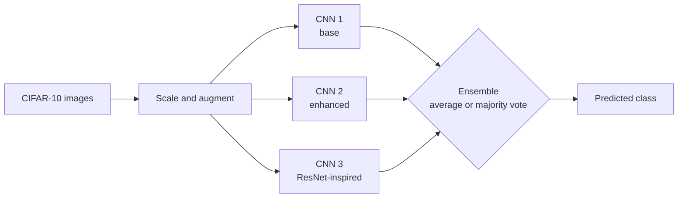

# Image-Classification-CNN

Three convolutional neural networks (CNNs) trained on CIFAR-10, with the best single model reaching 89% test accuracy and an ensemble of all three reaching 87.9%.

CIFAR-10 is a standard dataset of 60,000 small colour images (32 by 32 pixels) in 10 classes: airplane, automobile, bird, cat, deer, dog, frog, horse, ship and truck. A CNN is a neural network that learns image filters. An ensemble combines the predictions of several models.

## Problem and approach

The notebooks train models in steps, from a plain dense network up to a ResNet-inspired CNN (a network with skip connections), compare them on the same held-out test set, and then test whether combining the three best models helps.

1. The data is split into 40,000 training, 10,000 validation and 10,000 test images, with pixel values scaled to 0 to 1.
2. Training uses data augmentation: random rotations, shifts, flips, zoom and shear.
3. Model 1 is a base CNN with three convolution layers and dropout. Model 2 adds more convolution blocks and a larger dense head. Model 3 is the ResNet-inspired model with residual connections.
4. The ensemble either averages the three models' probabilities or takes a majority vote of their predicted classes.

## Architecture



## Results

All numbers are accuracy on the 10,000-image CIFAR-10 test set, taken from the classification reports and ensemble cells in `Notebooks/CNN_Image_Classification_Final_Draft.ipynb`.

| Model | Test accuracy |
|---|---|
| Dense network (baseline) | 47% |
| First plain CNN | 69% |
| CNN 1 (base) | 84% |
| CNN 2 (enhanced) | 86% |
| CNN 3 (ResNet-inspired) | 89% |
| Ensemble, averaged probabilities | 87.9% |
| Ensemble, majority vote | 87.4% |

The ensemble did not beat the best single model. CNN 3 alone scored higher than either way of combining the three. I kept this result in because it is what the notebook shows.

## Run it

The work is in the notebooks, and they were written for Google Colab (they import `google.colab`). Paths that point to Google Drive need editing to run locally.

```powershell
git clone https://github.com/unusual9guy/Image-Classification-CNN.git
cd Image-Classification-CNN
python -m venv .venv
.venv\Scripts\Activate.ps1
pip install -r requirements.txt
jupyter notebook Notebooks/CNN_Image_Classification_Final_Draft.ipynb
```

The trained models are in `Models/` as `.h5` files. The project reads no environment variables.

## Limitations and next steps

- The old README described a Streamlit app, `ensemble_classifier.py`, that is not in this repo. TODO: add it or remove the claim for good.
- The three `.h5` weight files (about 120 MB) are committed, so the repo is large to clone. Releases or Git LFS would suit them better.
- I compared models on the test set. A cleaner setup would pick models on validation data and touch the test set once.
- Accuracy is the only metric reported. Per-class results and a confusion matrix would show which classes the models confuse.

## Screenshot

TODO: add a plot of training curves or a confusion matrix from the notebook.
